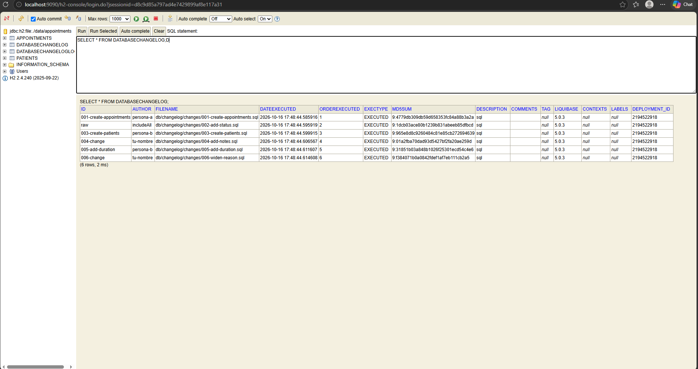
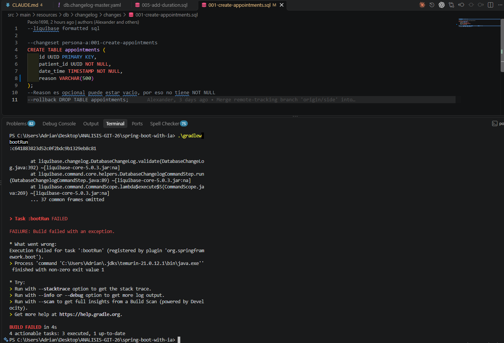

# Laboratorio: Migraciones de base de datos con Liquibase

**Curso:** IF-6100 Análisis y Diseño de Sistemas, UCR Sede del Atlántico
**Integrantes:** Paolo Arellano (Persona A), Adrian Barboza (Persona B)
**Repositorio:** https://github.com/paolo1698/spring-boot-with-ia

## Changesets

| # | Archivo | Autor | Descripción |
|---|---|---|---|
| 001 | `001-create-appointments.sql` | persona-a | Crea la tabla `appointments` |
| 002 | `002-add-status.sql` | `includeAll` (id registrado `raw`) | Agrega `status` a `appointments` |
| 003 | `003-create-patients.sql` | persona-b | Crea la tabla `patients` |
| 004 | `004-add-notes.sql` | tu-nombre | Agrega `notes` a `appointments` |
| 005 | `005-add-duration.sql` | persona-b | Agrega `duration_minutes` a `appointments` |
| 006 | `006-widen-reason.sql` | tu-nombre | ALTER COLUMN reason VARCHAR(255); no tiene efecto porque la columna ya era VARCHAR(255) |

## Pull Requests

| PR | Rama | Autor | Revisor |
|---|---|---|---|
| #2 | `feat/liquidbase-setup` | A | B |
| #4 | `feat/add-status-column` | A | B |
| #3 | `feat/add-patients-table` | B | A |
| #6 | `feat/add-notes` | A | B |
| #5 | `feat/add-duration` | B | A |
| #7 | `feat/widen-reason` | A | B |

## `SELECT * FROM DATABASECHANGELOG`

Captura tomada en `http://localhost:9090/h2-console` (JDBC URL `jdbc:h2:file:./data/appointments`, usuario vacío) después de aplicar `001`–`006`.



## Error de checksum (Parte 6)



```
Validation Failed:
     1 changesets check sum
          db/changelog/changes/001-create-appointments.sql::001-create-appointments::persona-a was: 9:4779db309db59d658353fc84a88b3a2a but is now: 9:c641883823d52c0f2bdc9b1329eb8c81
```

Cambio que provocó el error: `reason VARCHAR(255)` → `VARCHAR(500)` en `001`.
Solución aplicada: revertir con `git checkout -- <archivo>` y hacer el cambio mediante un changeset nuevo (`006`), sin editar el `001` ya aplicado. Nota: el `006` que quedó en `main` usa `VARCHAR(255)`, por lo que en la práctica no modificó la columna.

## Respuestas de los PR

### 1. ¿Por qué importa el orden de los `include`? (PR #4, Parte 4)

Liquibase ejecuta los changesets en el orden en que aparecen los `include` del master. Un changeset puede depender de objetos creados por uno anterior (por ejemplo, un `ALTER TABLE` sobre una tabla creada antes), así que cambiar el orden puede romper la migración o dejar un esquema distinto en cada base.

### 2. ¿Qué habría pasado si ambos mergeaban con el id duplicado? (PR #5, Parte 5)

Liquibase identifica cada changeset por la combinación `id` + `author` + ruta del archivo. Los changesets `004` tenían autores y archivos distintos, así que Liquibase no habría detectado un duplicado y habría aplicado ambos. Lo que se pierde es el orden y la trazabilidad: dos archivos `004` sin un orden claro y un id que ya no identifica un único cambio.

### 3. ¿Por qué no se debe editar un changeset ya aplicado? (PR #7, Parte 6)

Al aplicar un changeset, Liquibase guarda su checksum (MD5SUM) en `DATABASECHANGELOG`. Si el archivo cambia después, el checksum ya no coincide y la validación falla al arrancar. Aunque se forzara, las bases donde ya corrió no recibirían el cambio y quedarían distintas a las nuevas. Por eso cualquier modificación se hace con un changeset nuevo.

## Rollback (Parte 7)

- Se usó el plugin `org.liquibase.gradle` 3.1.0 y el comando `./gradlew rollbackCount -PliquibaseCount=2`, que revirtió `006-change` y `005-add-duration` (BUILD SUCCESSFUL).
- Al ejecutar `bootRun` otra vez, Liquibase reaplicó 005 y 006 sin errores, y la columna `duration_minutes` volvió a existir.
- Para que el plugin funcionara en Windows se quitó temporalmente el prefijo `classpath:` de los includes de 001 y 002 en el master; ese cambio y el plugin no se subieron al repositorio.
- El 006 no trae `--rollback`, así que se agregó localmente solo para la prueba.
